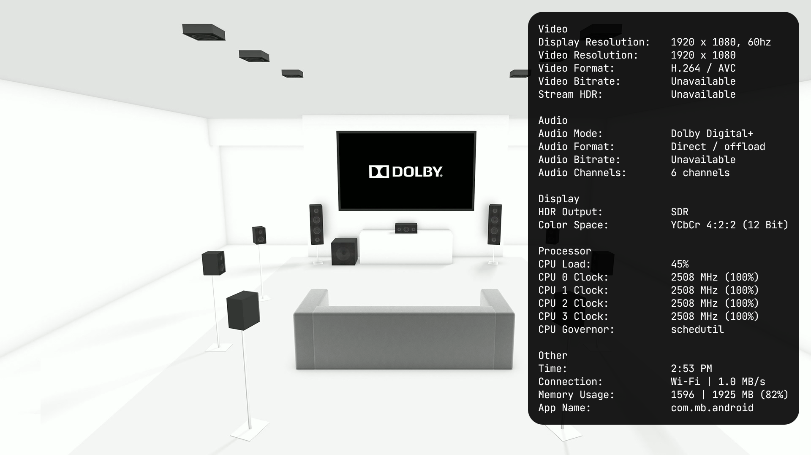

# Android VideoInfoOverlay

Experimental video information overlay for Android TV devices.
Compatibility with other devices is not guaranteed.

Based on Jamal's original application and the almirus source mirror.
Original attribution and MIT license are retained.

Package ID: `com.signde.androidvideooverlay`

[Download the latest experimental APK](https://github.com/signde/android-video-overlay/releases/latest/download/Android_VideoInfoOverlay.apk)
· [Release notes and older versions](https://github.com/signde/android-video-overlay/releases)

The direct APK link above also works in **Downloader** and stays the same for
future releases. Use it as the target when creating an [AFTVnews Downloader code](https://go.aftvnews.com/).

## Verified devices

- onn 4K Pro v2, Android TV 14
- onn 4K Plus, Android TV 14
- onn 4K Pro (2024), v21.1 (user-reported)
- onn 4K Streaming Device (2026), Android TV 14
- RockTek GX1, Android TV 14 (user-reported)
- Google TV Streamer 4K (contributor-reported)

Available metrics vary by device and playback app. Unsupported readings show
as unavailable; HDMI HDR output is not yet available on the tested Realtek devices.

## Setup and use

See the [installation guide](INSTALL_GUIDE.md) for guided setup, Downloader
installation, and help if the Accessibility toggle immediately switches off.

1. Install the APK and enable **Developer options > USB debugging** on the TV.
2. Open **Android VideoInfoOverlay** and follow its guided setup to authorize
   local ADB and allow restricted settings. Approve the TV's debugging prompt
   only if you trust this app. No computer commands are needed on supported devices.
3. Use the setup screen to enable **Android VideoInfoOverlay** in Accessibility,
   return with Back, and select **Show overlay and finish**. Leave debugging enabled
   on a trusted network. The app needs local ADB on port 5555; no root or any other
   helper is needed. Wireless debugging pairing alone is not sufficient.
4. Press the remote's **Favorites / Bookmark** button to show or hide the overlay.
   You can also open **Android VideoInfoOverlay** from the apps list to toggle it.

For appearance and remote-button settings, open **Settings > Accessibility >
Android VideoInfoOverlay > Configuration**, or **Overlay configuration** at the
bottom of the setup screen. Revisit setup through **Configuration > Setup / permissions**.
